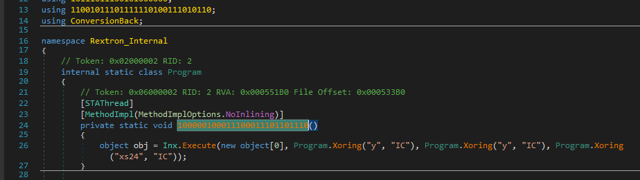
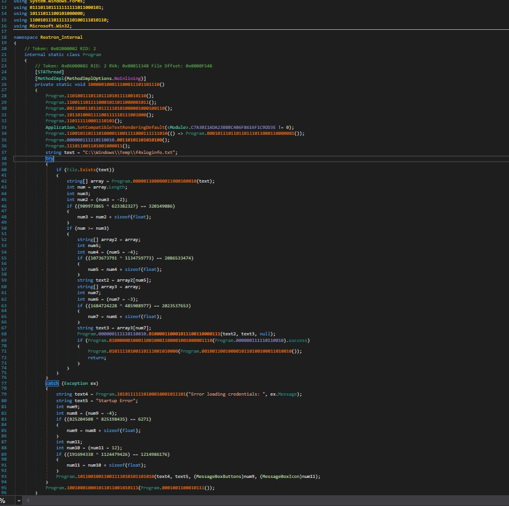

# InxDeobfuscator & Devirtualizer

A fast .NET 9 command-line devirtualizer and deobfuscator built with `dnlib` (`4.5.0`) for restoring Inx ("ConversionBack") protected .NET assemblies back to clean, readable IL.

## Before & After

### Before (Inx Virtualized Stub)



### After (Devirtualized & Cleaned)



## Features & Pipeline

1. **Inx Devirtualization (`Core/InxDevirtualizer.cs`, `Core/InxRuntime.cs`, `Core/NetFxRandom.cs`)**
   - Resolves the embedded initialization store referenced by `*.Init`.
   - Unmasks the encrypted resource bytes using a .NET Framework-compatible `System.Random` (`NetFxRandom`) mask.
   - Scans for `ConversionBack::Execute` stubs, derives per-method decryption keys from stub IL bytes and `MD5(method.Name) ^ "Class"`, decrypts serialized IL payloads via `RijndaelManaged`, and rebuilds `CilBody` instructions and exception handlers in place.
2. **Control-Flow Junk Removal (`Protections/JunkRemover.cs`, `Core/IlUtil.cs`)**
   - Strips redundant `unaligned.`, `volatile.`, and `readonly.` prefixes, fall-through `br`/`br.s` branches, `nop` padding, and unreachable blocks after unconditional terminators while rewiring branch, switch, and exception-handler targets to a fixpoint.
3. **Constant & Forwarding Proxy Removal (`Protections/ProxyRemover.cs`, `Core/Emulator.cs`)**
   - Emulates parameterless constant-returning proxy methods in dependency order and inlines their literal values.
   - Redirects single-call forwarding proxies straight to their underlying target methods.
4. **Static String Decryption (`Protections/StringDecryptor.cs`, `Core/Emulator.cs`)**
   - Detects integer-keyed string decryptor helpers, emulates call sites with compile-time constant arguments without executing anti-debug module initializers, and replaces them with `ldstr`.
5. **XOR String Scrambler Inlining (`Plugins/XoringStringInliner.cs`)**
   - Detects 1- and 2-argument string XOR scramblers structurally and folds constant call sites into plain `ldstr` literals.
6. **Base64 String Layer Cleaner (`Plugins/Base64StringInliner.cs`)**
   - Folds `Convert.FromBase64String` wrappers (`byte[]` and `string` variants) and `Encoding.GetString` calls (including local-variable `ldstr; stloc; ...; ldloc` patterns).
   - Normalizes wrappers and replaces `Encoding` getter proxies with direct BCL getters.
7. **Simple Forwarding Proxy Cleanup (`Protections/SimpleProxyRemover.cs`)**
   - Performs a final pass after string/base64 cleaning to collapse remaining chained forwarding proxies (`ldarg...; call/callvirt/newobj; ret`) and strip unreferenced proxy methods while preserving entry points, overrides, property/event accessors, and accessibility rules.
8. **Console UI & Output Verification (`Program.cs`, `Core/ConsoleUi.cs`)**
   - Displays per-stage progress timings, total restored methods, decrypted string counts, proxy/junk stats, remaining `Inx::Execute` / missing-operand checks, and the largest recovered method bodies.

## Project Structure

```text
Deobfuscator.csproj
Program.cs
Core/
  ConsoleUi.cs
  Emulator.cs
  IlUtil.cs
  InxDevirtualizer.cs
  InxRuntime.cs
  NetFxRandom.cs
Protections/
  JunkRemover.cs
  ProxyRemover.cs
  SimpleProxyRemover.cs
  StringDecryptor.cs
Plugins/
  Base64StringInliner.cs
  XoringStringInliner.cs
assets/
  before.png
  after.jpg
```

## Requirements

- .NET 9.0 SDK
- `dnlib` `4.5.0` (restored automatically via NuGet)

## Build

```powershell
dotnet build Deobfuscator.csproj -c Release
```

## Usage

Run the full devirtualization and deobfuscation pipeline:

```powershell
dotnet run -c Release -- <protected.exe> <output.exe>
```

Or invoke the compiled executable directly:

```powershell
Deobfuscator.exe <protected.exe> <output.exe>
```

### Utility Modes

Run only the Base64 string inliner & encoding-proxy remover:

```powershell
Deobfuscator.exe --b64 <protected.exe> <output.exe>
```

Dump `<Module>` fields, `.cctor` call patterns, and candidate string-decryptor IL:

```powershell
Deobfuscator.exe --dump <input.exe> <dump.txt>
```

Dump all non-whitespace string literals (`ldstr`):

```powershell
Deobfuscator.exe --dumpstr <input.exe> <strings.txt>
```
